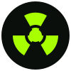

<div align="center">



# NuclearLang

**Escribe solo la lógica.** Un lenguaje mínimo hecho para que lo escriban los agentes de IA y lo lean las personas.
Un solo código se convierte en TypeScript, Dart o Python; **Synapsis**, su framework, construye apps móviles,
backends y apps web a partir de él.

[**nuclearlang.github.io**](https://nuclearlang.github.io) · [el repositorio](https://github.com/nuclearlang/lang) ·
[extensión de VS Code](https://marketplace.visualstudio.com/items?itemName=nuclearlang.nuclearlang) ·
[Discussions](https://github.com/nuclearlang/lang/discussions) · [English](README.md)

</div>

```sh
curl -fsSL https://nuclearlang.github.io/install.sh | sh     # Linux, macOS
irm https://nuclearlang.github.io/install.ps1 | iex          # Windows
```

| | |
|---|---|
| [**lang**](https://github.com/nuclearlang/lang) | Todo, en un repositorio: el lenguaje y su compilador, los dialectos, Synapsis y sus tres plataformas, el comando `nuclear`, el generador de código, el servidor MCP, los editores (VS Code, Cursor, Android Studio, IntelliJ, Zed), el Smart Graph, los agentes locales, los instaladores y el sitio web |
| [nuclearlang.github.io](https://github.com/nuclearlang/nuclearlang.github.io) | Publica el sitio web desde `lang` |

Libre y de código abierto, Apache-2.0. Las contribuciones son bienvenidas: empieza por un
[`good first issue`](https://github.com/nuclearlang/lang/labels/good%20first%20issue).
