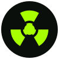

<div align="center">



# NuclearLang

**Write only the logic.** A minimal language made to be written by AI agents and read by people. One codebase
becomes TypeScript, Dart or Python; **Synapsis**, its framework, builds mobile apps, backends and web apps from it.

[**nuclearlang.github.io**](https://nuclearlang.github.io) · [the repository](https://github.com/nuclearlang/lang) ·
[VS Code extension](https://marketplace.visualstudio.com/items?itemName=nuclearlang.nuclearlang) ·
[Discussions](https://github.com/nuclearlang/lang/discussions) · [Español](README.es.md)

</div>

```sh
curl -fsSL https://nuclearlang.github.io/install.sh | sh     # Linux, macOS
irm https://nuclearlang.github.io/install.ps1 | iex          # Windows
```

| | |
|---|---|
| [**lang**](https://github.com/nuclearlang/lang) | Everything, in one repository: the language and its compiler, the dialects, Synapsis and its three platforms, the `nuclear` command, the code generator, the MCP server, the editors (VS Code, Cursor, Android Studio, IntelliJ, Zed), the Smart Graph, the local agents, the installers and the website |
| [nuclearlang.github.io](https://github.com/nuclearlang/nuclearlang.github.io) | Publishes the website from `lang` |

Free and open source, Apache-2.0. Contributions welcome: start with a
[`good first issue`](https://github.com/nuclearlang/lang/labels/good%20first%20issue).
